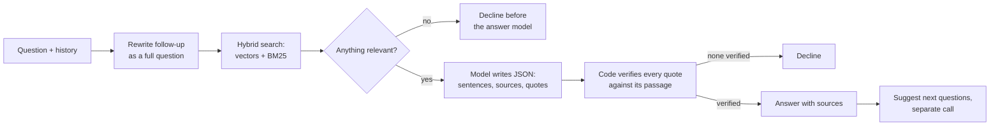

# Ask the Studio

A customer assistant for [Parure London](https://parurelondon.com), my jewellery brand. It answers only from the brand's own guides and policies, cites the passages its answer comes from, and says so when the answer isn't there.

**Live demo:** TBD_URL. Turn on **Staff view** (top right) for sources, how each answer was made, and the eval dashboard.

## Results

| Measure | Result |
|---|---|
| Eval set, automated checks (67 questions, mean of 3 runs) | **96%** (range 94 to 97) |
| Same set, baseline retrieval | 91% (range 90 to 93) |
| Graded by me, the brand owner (run 1: answers labelled blind, declines checked by rule) | **82%** (automated: 97% on the same run) |
| Held-out set (10 questions written near the end, never tuned on, run once) | 80% |
| Counterfactual test (edited facts) | 6 of 6 |
| Answered when it should have declined | 0 |
| Cost and median time per answer | about 0.15p, 2.8s |

96% is the regression baseline; 82% is the quality figure. The final runs used 67 cases; a 68th (t5, below) was added after them. The gap (97% vs 82% on the same run) is the LLM judge being lenient (see [What the evals showed](#what-the-evals-showed)).

## Run it

Requires Node 20+ and an OpenAI API key.

```bash
npm install
cp .env.example .env     # add OPENAI_API_KEY; Langfuse keys optional
npm run dev              # api on :3000
npm run dev:web          # ui on :5173, in a second terminal
npm test                 # 78 tests, offline
```

| Command | What it does |
|---|---|
| `npm run eval` | Eval set against the full system |
| `npm run eval:baseline` | Same set against the simpler retrieval |
| `npm run eval -- --repeat 3` | Mean, range and flaky cases across runs |
| `npm run eval:heldout` | Held-out set, reported separately |
| `npm run eval:counterfactual` | Answers against an edited copy of the knowledge base |
| `npm run eval:agreement` | Judge vs my labels |
| `npm run build && npm start` | One production server for the API and UI (also the Dockerfile) |

**API:** `POST /ask` with `{ "question": "...", "history": [] }` returns `{ answer, sources, ... }`. `POST /ask/stream` sends the same as server-sent events.

## How it works



## Key decisions

Reasoning and rejected alternatives: [docs/DESIGN.md](docs/DESIGN.md).

| Area | Decision | Why |
|---|---|---|
| Knowledge base | 31 markdown docs with deliberate traps: 2025 vs 2026 policies, an FAQ that oversimplifies, near-duplicates, a time-limited offer, gaps | The problems a real support knowledge base has |
| Chunking | Documents up to 220 words (policies up to 400) kept whole, so 29 of 31 are one chunk; only the about page and FAQ split on headings; every chunk indexed with its title (and section) as a header | A policy's sections qualify each other, and a product page's price, materials and size belong together |
| Retrieval | Embeddings + BM25, fused by rank, top 6, in memory | Embeddings for paraphrase, BM25 for prices, sizes and names; 37 chunks need no database |
| Old policies | Filtered out in code, attached only to explain a change | A prompt is a request, a filter is a guarantee |
| Grounding | Model returns sentences with sources and quotes; code checks every quote word for word and adds the citation numbers | The model left out inline citations in 25 of 26 answers when asked to write them |
| Declines | Written by the app; nothing relevant means no answer-model call | Consistent wording, the studio's email for real questions it can't answer, little cost for off-topic |
| Follow-ups | Rewritten into a full question for search, plus two passages for the customer's own words; suggestions from a separate call | The rewrite could drag a new question back to the old topic; suggestions in the same call repeated the answer |
| Security | No tools, input cleaned, prompt-leak check, personal data masked, rate limits | Threat model: [docs/SECURITY.md](docs/SECURITY.md) |
| Observability | Every question is a Langfuse trace, with eval scores and thumbs attached | How the last regression was found |

## What the evals showed

Method and full results: [docs/EVALS.md](docs/EVALS.md).

- **The judge is lenient.** I labelled 56 answers blind. 11 of 12 disagreements were the judge passing answers I failed (kappa 0.09). It passed answers with claims a customer would be misled by ("all sets come in one size", when LUNAR rings come in four) and answers that dodge the question.
- **The first run scored 17%,** almost all from one failure: the model wouldn't write inline citations. Making it a structured output, with code adding the numbers, took it to 90%. Each later failure became a fix and a test.
- **Generalisation:** 96% on questions it was tuned against, 80% on new ones. Both held-out failures were indirect returns questions ("what if I get an ugly pearl?") that left out the 30-day window.
- **Content caps quality.** Testing as the brand owner turned up wrong claims in the generated documents (adjustable bangles, a final sale), and labelling turned up an inconsistency in the real product copy ("nickel-free" on product pages vs "meets the EU Nickel Directive limits" in the materials guide). The assistant repeats what the documents say, so the fix is the content.

## With more time

| Next step | Fixes |
|---|---|
| A stricter judge: claim by claim, a different model, with the conversation history | The 97% vs 82% gap on the same run |
| Check each sentence against its cited passage, not just its quote | Claims a passage doesn't quite make |
| Return conditions and active offers checked in code | Both held-out failures, and the LUNAR offer case |
| Order lookup behind sign-in | "Where's my order?", declined today |
| Real customer questions and thumbs-down answers as eval cases | Tuning on my own questions |

## Production for thousands of users

| Area | Change |
|---|---|
| Outages and limits | Retry with backoff, a fallback model; if OpenAI is down, show the best FAQ match (BM25 runs locally) and the email |
| Serving | Stateless API scaled horizontally; rate limits and a cache in Redis; bot protection |
| Content | Postgres with pgvector, so every instance shares one index; re-embed only changed chunks; evals run when documents change |
| Cost | $0.0019 per answer: 10,000 a day is about $19 (£15); prompt caching; spend alerts |
| Quality | Langfuse dashboards; real questions and thumbs-down answers labelled into the evals weekly |
| Handoff | A decline or thumbs-down opens a ticket with the conversation attached |
| Privacy | Short retention, deletion on request, a data processing agreement with OpenAI |
| Access | Staff view behind a login; public API without answer metadata |

## How I built it

With Claude (Claude Code) as a pair programmer, which wrote most of the code. I set the direction, tested it as the brand owner, decided what to fix and what to leave, and labelled the evals. The commit history shows how it developed.
