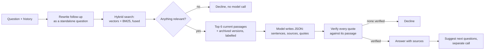

# Ask the Studio

A customer assistant for [Parure London](https://parurelondon.com), my jewellery brand. It answers questions only from the brand's own guides and policies, cites the passage behind every claim, and says so when the answer isn't there.

**Live demo:** TBD_URL. Turn on **Staff view** (top right) to see the sources, how each answer was made, and the eval dashboard.

**Results:** 96% of 67 eval questions pass by the automated checks (mean of 3 runs, range 94 to 97%), with no question answered that should have been declined. Two more honest numbers: 80% on 10 held-out questions written after the system was frozen, and 82% when I graded the answers myself, because the LLM judge turned out to be lenient. [More below](#what-the-evals-showed).

## Run it

Requires Node 20+ and an OpenAI API key.

```bash
npm install
cp .env.example .env     # add OPENAI_API_KEY (Langfuse keys optional)
npm run dev              # api on http://localhost:3000
npm run dev:web          # ui on http://localhost:5173, in a second terminal
npm test                 # 76 tests, offline (fake model and embedder)
npm run eval             # the eval suite; see docs/EVALS.md for the others
```

`npm run build && npm start` runs one production server for the API and the UI. The Dockerfile does the same.

## API

```bash
curl -s localhost:3000/ask -H 'content-type: application/json' \
  -d '{"question":"Is the silver hypoallergenic?"}'
```

```json
{
  "answer": "Yes. Our pieces are made from 316L stainless steel, which is hypoallergenic and meets EU Nickel Directive limits.[1]",
  "answerable": true,
  "sources": [{ "n": 1, "docId": "materials", "title": "Materials and Skin Sensitivity", "section": "Sensitive skin",
                "quotes": ["316L stainless steel is hypoallergenic and meets the EU Nickel Directive limits for jewellery"],
                "archived": false, "effectiveFrom": "2026-09-01", "url": "https://parurelondon.com/materials" }],
  "followUps": ["What if I have a severe nickel allergy?"],
  "meta": { "traceId": "…", "latencyMs": { "total": 2400 }, "costUsd": 0.0019, "retrieved": ["…"] }
}
```

`POST /ask` takes `{ question, history? }`. `POST /ask/stream` is the same as server-sent events: `delta` while writing, `result` once verified, then `followups`. Also `POST /feedback` (thumbs up or down), `GET /evals/latest` and `GET /health`.

## How it works



## Key decisions

The reasoning and the alternatives I rejected are in [docs/DESIGN.md](docs/DESIGN.md).

**Knowledge base.** 31 markdown documents with the problems a real one has: 2025 and 2026 versions of the returns and delivery policies, an FAQ that oversimplifies the care guide, near-duplicates, exceptions that span sections, a time-limited offer, and gaps. Each document's frontmatter records its type, effective date and what it replaces, and is validated at ingest.

**Chunking.** Product pages and policies stay whole, because their parts qualify each other: an earrings exception means nothing without the 30-day window it belongs to. Longer guides split on headings. Every chunk is indexed with a header (`SOLAR Necklace > Size`), so a bare "40cm" is still found.

**Retrieval.** Hybrid: embeddings for paraphrase ("send it back"), BM25 for exact prices, sizes and product names, fused by rank. In memory, because 37 chunks take under a millisecond to scan. Old policy versions are **filtered out in code**, then attached only to explain a change, so a superseded policy can never be presented as current.

**Prompting.** The model returns strict JSON: sentences that each name their sources, plus a verbatim quote per source. **Code, not the model, adds the citation numbers**, after checking every quote word for word against its passage. An answer with no verified quote becomes a decline, and every quote a customer sees is the document's own words. A sentence can still say a little more than its quote, which is what the human labelling caught. Declines and the "email the studio" line are written by the app, so the way to a person is never forgotten. Today's date goes with every question, for time-limited offers.

**Evaluation.** 67 questions across eight groups, including customer-style phrasing, conversations and security attacks. Each is scored on facts (exact matching), decline decisions, retrieval and an LLM judge, with repeat runs to separate real changes from randomness. A held-out set checks generalisation, a counterfactual test checks answers follow the documents, and blind human labels check the judge. Details in [docs/EVALS.md](docs/EVALS.md).

**Security.** No tools, so an injection can't make it *do* anything; quotes are verified; personal data is masked in logs, traces and answers; rate limits, a daily cap and a relevance gate control cost. Threat model in [docs/SECURITY.md](docs/SECURITY.md).

**Observability.** Every question is a Langfuse trace (rewrite, retrieval scores, generation, quote verification, suggestions), with eval scores and customer thumbs attached. A trace is how the last regression was found.

## What the evals showed

| | Full system | Baseline |
|---|---|---|
| Pass rate (mean of 3 runs) | **96%** (94 to 97) | 91% (90 to 93) |
| Retrieval recall@6 | **98%** | 95% |
| Grounded, by the judge | 100% | 100% |
| Grounded, by me (56 answers, labelled blind) | 93% | |
| Answered when it should have declined | 0 | 0 |
| Held-out set (run once) | 80% (8 of 10) | |
| Counterfactual test | 6 of 6 | |
| Pass rate when I graded the answers myself | 82% (55 of 67) | |
| Judge agrees with me (Cohen's kappa) | 79% (0.09) | |
| Cost and median time per answer | about 0.15p, 2.8s | |

The baseline uses vector search only, with old policies mixed in; same prompt, model and judge. The ranges across runs don't overlap, so the 5-point gap is real, not noise. The headline findings:

- **The evals drove the design more than the first plan did.** The first run passed 17%: the model left out the citation markers it was told to write in 25 of 26 answers. Making it declare sources per sentence, with code adding the numbers, fixed what an instruction couldn't. Each later failure led to a specific change, and became a test.
- **A better prompt narrowed the gap to the baseline, but I kept the code-level guarantees.** Early on, the baseline gave stale policies (free delivery from £75) in four of five runs. As the prompt improved, the baseline learned to pick the current version itself. Filtering old versions in code still stays, because a prompt is a request and a filter is a guarantee.
- **The assistant can only be as right as its content.** Testing as the brand owner turned up wrong claims in the generated documents (adjustable bangles, a final sale). The assistant had repeated them faithfully. The fix was the content, and in production that means an owner for content and evals that run whenever a document changes.
- **Not every failure is the system's.** Five failures at one stage were the eval's own fault: a plural not matching, and a judge marking down an answer for refusing an injection. I read every failing answer before changing anything, and kept eval fixes in their own commits.
- **The judge is too lenient, and the labelling is how I know.** I labelled the 56 answers blind. The judge agreed with me 79% of the time, but a kappa of 0.09 means that's almost all chance, since it says yes to nearly everything. 11 of the 12 disagreements were the judge passing answers I failed. I failed answers for three reasons:
  - **Small unsupported claims.** "Nickel-free" for a severe allergy, when the passage only says "meets EU nickel limits". "All sets are one size", when LUNAR rings come in four. Quotes are verified, but a sentence can go further than its quote.
  - **Answers that don't answer the question** ("which collection would be best?").
  - **Missing information a customer needs** (import duties when posting abroad).

  So the 96% is the automated score, and 82% is mine.
- **The held-out gap is the honest number.** 96% on the questions it was developed against, 80% on new ones. Both held-out failures are indirect returns questions ("what if I get an ugly pearl?") that left out the 30-day window.

## With more time

1. **Conditions checked in code, not just asked for.** If an answer offers a return, it must state the window and condition, or the app adds them. This fixes both held-out failures.
2. **Active offers checked the same way** (the one case that fails every run), and collection questions retrieving every piece in the collection.
3. **Order questions** ("where's my order?") through a read-only order lookup behind sign-in. This is the most common real support question, and declined today.
4. **A stricter judge.** Check claim by claim against the passages instead of the answer as a whole, use a different and stronger model, and give it the conversation history. Then re-measure agreement against my labels.
5. **Real questions as tests:** the support inbox and thumbs-down answers into the eval set. `npm run feedback:export` already drafts cases from feedback.

## Taking it to production for thousands of users

- **Content.** Ingestion moves to a job triggered by content changes, with chunks and vectors in Postgres (pgvector plus full-text search). The content-hash cache means only changed chunks are re-embedded. Content gets an owner, and evals gate document changes as well as code.
- **Serving.** The API is stateless, so it scales horizontally. Rate limits, the daily cap and feedback move to Redis. Common questions are cached by question plus knowledge base version. Bot protection goes in front.
- **Cost.** Simple lookups go to the smallest model that passes the evals. The prompt is ordered for provider prompt caching. Cost per answer is tracked with alerts. At today's figures, 10,000 questions a day is about £15 in model costs.
- **Quality in production.** Langfuse dashboards for decline rate by reason, dropped quotes, latency and cost, which are early signs of a bad change or a content gap. A sample of real traffic goes into the evals weekly. A clear handoff to a person when it declines.
- **Access.** Staff view behind a login, and the public API stops returning answer metadata.

## Project layout

```
knowledge-base/   31 markdown documents (products/ holds 15 product pages)
src/
  kb/             loading and validation, chunking, index build
  retrieval/      embeddings and cache, BM25, rank fusion, retriever
  answer/         prompts, pipeline, streaming, quote verification, output safety
  server/         Hono app, rate limits, redaction, logging
  observability/  Langfuse tracing
evals/            datasets, scoring, judge, runners, reports/
web/              React and Vite: chat, staff view, eval dashboard, labelling page
docs/             DESIGN.md, EVALS.md, SECURITY.md
```

Built with AI coding tools throughout, as the brief invited. The commit history shows how it developed, including the testing as the brand owner that drove many of the changes.
