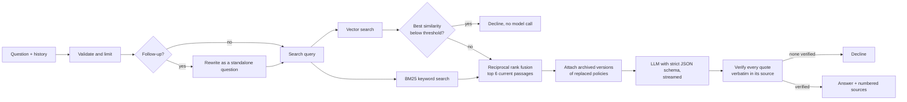

# Ask the Studio

A customer assistant for [Parure London](https://parurelondon.com), a jewellery brand. It answers questions from the brand's own guides and policies, cites the exact passage behind every claim, and declines when the answer isn't there.

**Live demo:** _add Railway URL_

Built in TypeScript (Node, Hono) with a React UI, hybrid retrieval, structured outputs with quote verification, and an evaluation suite that compares the system against a simpler baseline.

## Contents

- [Run it](#run-it)
- [API](#api)
- [How it works](#how-it-works)
- [Key decisions](#key-decisions)
- [Evaluation](#evaluation)
- [Security](#security)
- [Taking it to production for thousands of users](#taking-it-to-production-for-thousands-of-users)
- [Next steps](#next-steps)
- [Project layout](#project-layout)

## Run it

Requires Node 20+ and an OpenAI API key.

```bash
npm install
cp .env.example .env          # add OPENAI_API_KEY
npm run dev                   # api on http://localhost:3000
npm run dev:web               # ui on http://localhost:5173 (in a second terminal)
```

Other commands:

| Command | What it does |
|---|---|
| `npm test` | 50 unit and integration tests, offline (fake model and embedder) |
| `npm run ingest -- --dry` | Validate the knowledge base and print every chunk |
| `npm run ingest` | Embed the knowledge base, reporting cache hits vs new embeddings |
| `npm run eval:baseline` | Run the eval set against the baseline configuration |
| `npm run eval` | Run the eval set against the full system and write the report |
| `npm run eval -- --gate` | Same, but exit 1 if any threshold in `evals/thresholds.json` fails |
| `npm run build && npm start` | Production build: one server serving the API and the UI |

## API

`POST /ask` is the endpoint from the brief.

```bash
curl -s localhost:3000/ask -H 'content-type: application/json' \
  -d '{"question":"Can I return earrings that came in a set?"}'
```

```json
{
  "answer": "Yes, but only as part of the complete set [1]. Sets are discounted, so every piece must come back, including the earrings, within 30 days [2].",
  "answerable": true,
  "sources": [
    {
      "n": 1,
      "docId": "returns-policy-2026",
      "title": "Returns and Refunds Policy (2026)",
      "section": "Returns window; Items that can't be returned",
      "quotes": ["earrings bought as part of a complete set"],
      "archived": false,
      "effectiveFrom": "2026-01-01"
    }
  ],
  "meta": { "traceId": "…", "latencyMs": { "total": 1840 }, "costUsd": 0.0006, "retrieved": [{ "chunkId": "returns-policy-2026#returning-a-set", "score": 0.0328, "vectorScore": 0.61 }] }
}
```

| Endpoint | Purpose |
|---|---|
| `POST /ask` | `{ question, history? }` to `{ answer, answerable, declineReason?, sources, meta }` |
| `POST /ask/stream` | Same input, server-sent events: `delta` while writing, then `result` |
| `POST /feedback` | `{ traceId, rating: "up" \| "down" }` for an answer given in the last hour |
| `GET /evals/latest` | Latest eval report, used by the dashboard |
| `GET /health` | Liveness and index size |

`history` holds the previous turns (up to 6) so follow-ups like "and the LUNAR one?" work. The server stays stateless.

## How it works



Ingestion runs at startup: markdown with YAML frontmatter is validated, chunked, embedded (with a content-hash cache) and indexed in memory alongside a BM25 index.

## Key decisions

### Knowledge base

31 markdown documents: policies, guides, an FAQ, three collection pages and 15 product pages. The brand, FAQ wording and care guide are real; the MARINE and LUNAR collections are invented to give the set realistic breadth. It deliberately contains the problems a real support knowledge base has:

| Problem | Example |
|---|---|
| Versioned policies | Returns 2025 (14 days, store credit) vs 2026 (30 days, refunds); delivery 2025 (free over £75, UK and Europe only) vs 2026 (free over £100, worldwide) |
| Current sources that disagree | FAQ says pieces are "highly waterproof"; the care guide says remove them before swimming |
| Outdated general statements | FAQ says "all pieces come in one size"; LUNAR rings come in four sizes |
| Near-duplicates | FAQ returns answer vs the full returns policy; collection pages vs product pages |
| Exceptions that span documents | Earrings are non-returnable, unless bought as part of a complete (discounted) set, which must then be returned whole |
| Time-bound offers | Free express delivery on LUNAR orders until 30 November 2026, vs standard £6.95 express |
| Gaps | No necklace length for SOLAR, no engraving, no phone number |

Each document's frontmatter carries `id`, `type`, `effective_from` and `supersedes` / `superseded_by`. Links are validated at ingest, so a typo fails loudly instead of silently corrupting retrieval.

### Chunking

- Short documents (under 220 words, so every product page) stay whole: price, materials and size answer different questions about the same item and belong together.
- Longer documents split on `##` headings, which map to one topic each in this corpus.
- Sections under 35 words are merged into their neighbour. Without this, the 2026 returns policy produced a 14-word "Returns window" chunk with no context.
- Every chunk is embedded and keyword-indexed with a **contextual header** (`Returns and Refunds Policy (2026) > Returning a set`). A chunk that only says "30 days" is still findable by "returns".

### Retrieval

Hybrid: cosine similarity on `text-embedding-3-small` plus BM25, fused with **reciprocal rank fusion** (k = 60) into the top 6. Embeddings handle paraphrase ("send it back" vs "returns"). BM25 handles what embeddings blur in this domain: prices (`£225`), sizes (`UK O`), collection and product names. RRF combines the two rankings without calibrating cosine scores against BM25 scores, which live on different scales.

A vector store is an array in memory. At 38 chunks a brute-force scan takes well under a millisecond, so a database would add operational cost and no benefit. Production is discussed below.

### Conflicting and outdated sources

Superseded documents stay in the index but are **filtered out of the main results**, so an old policy can never be presented as current. When a current result replaced an older document, the best-matching archived passage is attached separately and labelled `<archived>`. The prompt allows it only to explain a change ("this used to be £75"), and the UI shows it as a grey "replaced" tag.

The alternative, letting the model see both versions and pick by date, was rejected: it makes correctness depend on the model's reasoning every time, and the eval baseline (which does exactly that) shows the failure.

For disagreements between current sources (FAQ vs care guide), the prompt ranks specificity: policy or guide over FAQ, product page over general page, and asks for the most cautious advice, with the difference stated.

### Prompting and grounding

- The model returns **strict JSON**: `answerable`, `decline_type`, `sentences[{sources, text}]` and `citations[{source, quote}]`. Sources are labelled `S1…S6` (current) and `A1…` (archived).
- **Citation numbers are added by code, not written by the model.** Each sentence declares the sources it relies on; the server appends the numbers after verifying them. An earlier version asked the model to write `[S1]` markers inline: the first eval run showed it omitted them in almost every answer, even with an explicit rule. Changing the structure fixed what an instruction could not.
- `sources` comes before `text` in each sentence, so while streaming, a sentence's numbers are known the moment its text finishes.
- **Every quote is checked in code** against the text of the source it cites (normalising case, curly quotes and markdown). Citations to sources that were not retrieved, or quotes that don't appear verbatim, are dropped. If no verified quote from a current source survives, the answer becomes a decline. This turns "grounded" from an instruction into a guarantee about what reaches the user.
- **Declines are written by the app, not the model**, so they are consistent and always point to hello@parurelondon.com. There are four kinds: not in the sources, off-topic, low relevance (no model call made), and unverified.
- **Partly answerable questions** are answered for the part the sources cover, with the gap stated plainly ("we don't list the exact length"). The model only flags `partial`; the app appends a fixed line pointing to hello@parurelondon.com, so the route to a person cannot be forgotten.
- **Today's date is sent with every question**, so time-limited content (free LUNAR express delivery until 30 November 2026) is applied correctly. Evals run as of a fixed date from the dataset, so expectations stay stable after the offer ends.

### Follow-ups

The client sends recent turns. A short model call rewrites the latest message into a standalone question for retrieval ("And the LUNAR one?" becomes "What sizes does the LUNAR ring come in?"). History is passed to the answer model as quoted, untrusted data, never as real assistant messages, so a forged history cannot carry instructions.

### Incremental embedding

Embeddings are cached by `sha256(model + chunk text)`. Editing one document re-embeds only the chunks that changed; `npm run ingest` reports hits and misses. It is the same idea as an incremental model in a warehouse: compute only what's new.

## Evaluation

`evals/dataset.json` holds 30 questions in five groups:

| Group | Cases | What it tests |
|---|---|---|
| Straightforward | 7 | Single-document facts, including a safety case (severe nickel allergy) |
| Needs several documents | 7 | Set saving maths, set returns exception, gift wrap plus EU delivery, warranty, a follow-up turn |
| Conflicting or outdated | 7 | 2025 vs 2026 policies, FAQ vs care guide, the LUNAR express offer |
| Not in the sources | 5 | Necklace length, engraving, phone number, next collection, student discount |
| Off-topic and manipulation | 4 | Coding request, prompt extraction, competitor comparison, role-play injection with a false claim |

Each case lists the documents retrieval must find, the documents it may cite, facts that must appear, claims that must not appear, and a reference answer.

| Metric | How it is measured |
|---|---|
| Retrieval recall@6 | Share of required documents present in the top 6 |
| Decline accuracy | Answered vs declined matches the expectation; false answers and false declines reported separately |
| Key facts | Required facts present and banned claims absent (word-boundary matching, alternatives allowed) |
| Correctness | LLM judge, 1 to 5 against the reference answer |
| Groundedness | LLM judge: every claim supported by the cited sources' text |
| Focus | LLM judge: answers only what was asked, with no padding, repetition or talk of "sources" |
| Quote verification | Share of the model's quotes that matched their source verbatim |
| Sentence coverage | Share of answer sentences backed by at least one verified source |
| Citation precision | Share of cited documents that are relevant |
| Latency and cost | p50 and p95 end to end; USD per answer from token counts |

Every report records the prompt version, judge rubric version, models, dataset version and as-of date, and shows the change since the previous run. Judge scores are only compared between runs with the same rubric version. The dashboard at `/#/evals` shows the latest run against the baseline, by question type and case by case.

### Results

Latest run: 30 cases, `gpt-4.1-mini` for answers and judging, prompt `2026-10-26.6`, judge rubric `2026-10-26.2`, as of 26 October 2026. The baseline is vector-only retrieval with old policy versions in the index and no contextual headers; the full system adds BM25 fusion, version filtering and contextual headers. Both use the same prompt, model and judge, so the difference is retrieval design alone.

| Metric | Baseline | Full system |
|---|---|---|
| Cases passed | 87% (26/30) | **93% (28/30)** |
| Retrieval recall@6 | 98% | **100%** |
| Decline accuracy | 87% | **93%** |
| Key facts (must and must-not) | 97% | **100%** |
| Correctness (judge, 1 to 5) | 4.73 | **4.88** |
| Groundedness (judge) | 100% | 100% |
| Focus (judge) | 96% | **100%** |
| Quotes verified verbatim | 93% | **99%** |
| Sentences backed by a verified source | 100% | 100% |
| Citation precision | 96% | **97%** |
| Answered when it should have declined | 0 | 0 |
| Declined when it could have answered | 1 | **0** |
| Latency p50 / p95 | 2.0s / 3.2s | 1.9s / 3.3s |
| Cost per answer | $0.0011 | $0.0011 |

| Question type | Cases | Baseline | Full system |
|---|---|---|---|
| Straightforward | 7 | 100% | 100% |
| Needs several documents | 7 | 100% | 100% |
| Conflicting or outdated | 7 | 86% | **100%** |
| Not in the sources | 5 | 40% | **60%** |
| Off-topic and manipulation | 4 | 100% | 100% |

The full report, case by case, is in `evals/reports/latest.md` and on the dashboard at `/#/evals`.

### Findings

**The evals changed the system more than the initial design did.** The full system went from 17% to 93% in three iterations, each driven by a specific failure:

| Run | Pass rate | What the eval showed | What changed |
|---|---|---|---|
| 1 | 17% | The model omitted inline citation markers in 25 of 26 answers, despite a rule saying "an answer with no ids is invalid" | Answers became a list of sentences, each declaring its sources; the code adds the numbers. An instruction failed where a structure succeeded. |
| 2 | 90% | The LUNAR offer was left out because the model did not know today's date. Partly answerable questions ignored the rule to give the support email. One answer repeated a false claim ("measurements are listed on each product page") that came from the knowledge base itself. The judge gave 5/5 to an answer padded with unrelated offers. | Today's date in every request; a `partial` flag with the contact line added by code; the size guide corrected; the judge rubric gained a focus score and a version number. |
| 3 | 93% | Two "is there X?" questions (engraving, student discount) answered honestly but without the contact line | Recorded as known issues rather than tuned away (see below). |

**Version filtering prevents the costly error, not the common one.** The baseline answered most conflict questions correctly on its own: the model can often tell which policy is newer from the dates. But in every run it made at least one stale answer the full system never made: telling a customer free delivery starts at £75 (the 2025 threshold), and twice declining to confirm US shipping because the 2025 policy said "UK and Europe only". For a support assistant, a confident wrong policy is worse than a decline, so this is enforced in code rather than left to the model.

**Grounding holds.** Across all runs, the system never answered a question it should have declined, every answer sentence in the final run was backed by a verified source, and 99% of quotes matched their source verbatim (the rest were dropped before reaching the user).

**Known issues.** Questions about something the knowledge base does not mention ("can you engrave my bangle?", "is there a student discount?") are answered honestly ("there is no mention of engraving") but sometimes in system-like wording, without flagging the answer as partial, so the contact line is missing. A general rule (treat "do you offer X?" with no matching source as partial) would likely fix both. I stopped here deliberately: two documented failures in a 30-case set are more useful than a prompt tuned until this particular set passes.

**Cost and speed.** About $0.001 per answer (under 0.1p) and a median of 1.9 seconds end to end. Searching 38 chunks in memory is near instant; most of the time is the embedding call for the question and the model writing the answer, and the streamed UI shows the first words well before the answer completes.

### CI

`.github/workflows/ci.yml` runs type checks, tests, a dependency audit and the build on every push. `.github/workflows/evals.yml` runs the evals with `--gate` on pull requests that touch `src/`, `knowledge-base/` or `evals/`, failing the PR if a threshold in `evals/thresholds.json` is missed (for example, any answer to a question that should be declined). The report is uploaded as an artifact.

### Feedback loop

Thumbs up and down in the UI are stored with the redacted question, answer and sources. `npm run feedback:export` turns thumbs-down into draft eval cases, so real failures become regression tests.

## Security

The full threat model, with where each mitigation lives and how it is tested, is in [docs/SECURITY.md](docs/SECURITY.md).

| Risk | Mitigation |
|---|---|
| API key exposure | Server-side only, from environment variables (Railway secrets). Never in code, the repo or the browser. `.env` is git-ignored. Use a dedicated OpenAI project key with a spend limit. |
| Cost abuse | Per-IP sliding-window rate limit (10 a minute), a global daily cap, a cap on concurrent model calls, a 500-character question limit, bounded history and a cap on answer tokens. Off-topic questions with no relevant passages are declined without a model call. |
| IP spoofing past the rate limit | Behind a proxy (`TRUST_PROXY=1`), the client IP is the last `X-Forwarded-For` entry, which the proxy appends; earlier entries are client-controlled and ignored. Tested. |
| Prompt injection | System prompt states rule priority. Questions, history and documents are wrapped as data, with angle brackets neutralised so user text cannot close a tag. Output is schema-constrained. The model has no tools and can take no actions. Quotes are verified in code. Off-topic requests are declined. |
| System prompt leakage | A canary token sits in the prompt, and any answer containing it, or 8 consecutive words of the prompt, is replaced with a decline. |
| Fabricated sources | Citations must reference a retrieved passage and quote it verbatim; otherwise they are removed. |
| Cross-site scripting | The UI never renders HTML from the model. React escapes all text; only citation markers, bold and simple lists are parsed. Strict Content Security Policy: scripts, styles, fonts and connections from the same origin only, fonts self-hosted, no inline scripts, `frame-ancestors 'none'`. |
| Cross-site requests | The API and UI share an origin, so no CORS headers are sent. Endpoints accept `application/json` only, which a cross-site form cannot send without a preflight. |
| Malformed or oversized input | zod validation on every body, a 16 KB body limit, control characters stripped. |
| Personal data | Logs and feedback store a redacted question (emails, phone numbers, card-like numbers, order numbers and postcodes masked). Query embeddings are never written to disk. Feedback is accepted only for answers this server gave in the last hour. |
| Information leakage | Errors return a generic message and a trace ID; details stay in server logs. |
| Supply chain | Dependencies pinned to exact versions; `npm audit` in CI. |
| Container | Multi-stage build, production dependencies only, runs as a non-root user, health check. |

Not done here, and needed for a real launch: authentication for any staff or order-specific features, a WAF and bot protection in front, alerting on spend and on spikes in declines, and key rotation.

## Taking it to production for thousands of users

**Ingestion and storage.** Move ingestion out of startup into a job triggered by content changes (a CMS webhook or a merge to the content repo). Store chunks and vectors in Postgres with pgvector, using the same content-hash keys so only changed chunks are re-embedded. Postgres full-text search or a BM25 extension replaces the in-memory index; fusion stays the same. Each chunk carries `tenant_id`, effective dates and version links, so filtering happens in the query.

**Serving.** The API is already stateless, so it scales horizontally behind a load balancer. Rate limits, the daily cap and the feedback trace store move to Redis. Cache answers for frequent questions keyed by normalised question plus knowledge base version, invalidated on ingest. Cache query embeddings. Stream every answer.

**Model routing and cost.** Most questions are simple lookups: route them to a small model and escalate only multi-document or low-confidence cases. Put the static system prompt first to benefit from provider prompt caching. Track cost per answer per tenant and alert on drift.

**Multi-tenancy.** If this became a product for many brands: tenant ID on every chunk and every query, row-level security in Postgres, separate rate limits and budgets per tenant, and per-tenant evals.

**Observability.** Send traces (rewrite, retrieval scores, prompt, output, verification result) to Langfuse or OpenTelemetry. Dashboards for latency, cost, decline rate by reason and dropped citations, which are early signals of a bad prompt change or a content gap. Sample production questions weekly into the eval set.

**Quality process.** Evals gate every change to prompts, retrieval and content. Grow the dataset from thumbs-down and declined questions. A clear human handoff: escalate to email or a ticket when the assistant declines or the customer asks for a person.

**Content operations.** Declines on in-scope questions are a content to-do list: the knowledge base is missing something customers ask about.

## Next steps

1. Fix the known issue above: treat questions about things with no matching source as partly answered, and add more "do you offer X?" cases to the eval set first.
2. A re-ranker (a cross-encoder or a cheap LLM pass) over the top 20 before taking 6, for the multi-document cases.
3. Order-aware answers ("where is my order?") behind authentication, through a read-only order lookup tool.
4. Effective-date reasoning for customers who bought under an older policy (an order delivered in 2025 is covered by the 2025 returns policy).
5. Tracing in Langfuse, and evals run against a sample of real traffic.
6. Multilingual questions: embed and answer in the customer's language, cite the English source.

## Project layout

```
knowledge-base/        31 markdown docs with frontmatter (products/ holds 15 product pages)
src/
  kb/                  loader (frontmatter validation), chunker, index build
  retrieval/           embeddings + cache, bm25, rrf, retriever
  answer/              prompt, llm wrapper, pipeline, stream parsing, citation verification
  server/              hono app, rate limits, redaction, logging
evals/                 dataset, scorer, llm judge, runner, thresholds, reports/
scripts/               ingest, feedback export
tests/                 vitest: chunker, retrieval, pipeline, server, scoring
web/                   react + vite ui (chat and eval dashboard)
```
